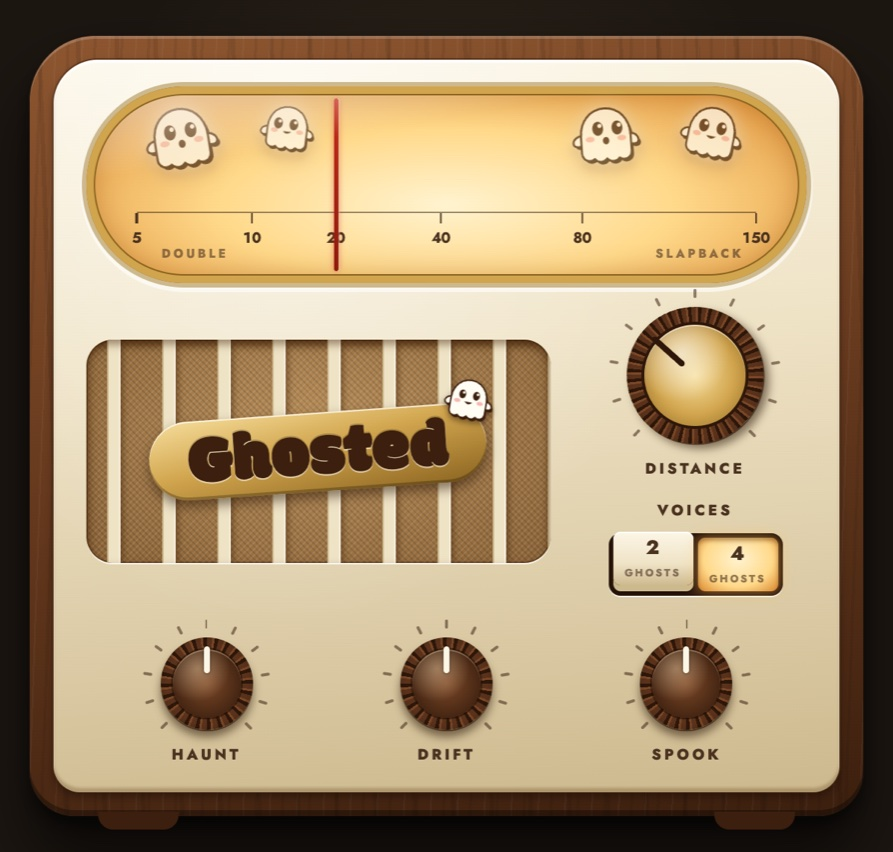

# Ghosted



Drifting double-tracking for guitar, vocals or anything else, as a
VST3 and CLAP plugin for macOS and Windows. It adds two or four delayed
copies of the input that wander in time like extra takes, from tight
ADT out to Abbey Road-style slapback.

## How it works

1. The input is summed to mono and fed to four delay lines: a tight and
   a loose voice on each side. In 2-voice mode only the tight pair
   plays, hard left and right.
2. Each voice's delay time drifts with smoothed random motion, which
   also bends its pitch a little, like a second take that isn't quite
   in time.
3. A transient detector catches pick attacks and kicks each voice early
   or late for a moment, so the ghosts don't land exactly together.
4. Each voice has its own band-pass EQ, so the copies sound like
   different takes rather than the same one repeated.

Knob moves glide, and fast Distance changes dip the pitch like tape
instead of clicking.

## Controls

| Control | Range | What it does |
|---|---|---|
| Haunt | 0–100% | Wet mix. The dry signal turns down as the ghosts come up |
| Distance | 5–150 ms | Base delay. Under about 40 ms it thickens like double tracking; above 80 ms it's a slapback |
| Drift | 0–100% | How far (up to 32 ms) and how fast (0.1–0.9 Hz) the ghosts wander, and how far the loose pair strays from the tight pair |
| Spook | 0–100% | How far (up to 20 ms) and how long (15–165 ms) each pick attack pushes the ghosts early or late |
| Voices | 2 / 4 | 2: the tight pair, hard left and right. 4: adds a loose, later voice on each side |
| Stomp | On / Off | The footswitch. Off fades the ghosts out and leaves the dry signal untouched |

Drag a knob up or down (hold Shift for fine moves), scroll, or use the
arrow keys. Double-click a knob to reset it. Click the footswitch to
turn the ghosts on and off; the pilot lamp shows which.

## Tips

- For classic ADT, keep Distance under 30 ms and Haunt around 50%.
- For a '50s slapback on a vocal or a rockabilly guitar, set Voices to 2,
  Distance to 90–130 ms, and Drift low.
- Turn Spook down on strummed parts, where every strum is a transient
  and the ghosts never settle.

## Installing

Download the zip from
[Releases](https://github.com/starzonmyarmz/ghosted/releases) and follow
`INSTALL.txt` inside it.

## Building

```sh
cargo xtask bundle ghosted --release       # target/bundled/Ghosted.{vst3,clap}
scripts/bump.sh [patch|minor|major]        # bump the version (patch by default)
scripts/install.sh                         # bundle, sign ad hoc and install on macOS
scripts/clap-validator.sh target/bundled/Ghosted.clap
```

## Tests

`cargo test` runs the engine offline: a guitar DI rendered against
stored stereo golden renders (double-tracked and slapback), plus
synthetic tests for the controls, gliding and sample rates. After an
intended change to the sound, rerun with `BLESS=1` to rewrite the
renders, and listen to them before committing.

## Working on the UI

The editor is a webview showing `ui/index.html`, which is compiled into
the plugin. Without the plugin, the page runs against a mock, so you can
work on it in a browser:

```sh
cd ui && python3 -m http.server 8765    # open http://127.0.0.1:8765
```

Add `?version=1.2.0` to show a version other than `0.0.0`. To load
the page live in the plugin, set `GHOSTED_UI_URL` to that URL
before starting the host.

## CI and releases

- `check.yml` runs on pushes to main and on PRs: the tests and
  clap-validator on macOS, and clap-validator on the Windows build.
- `release.yml` runs on `vX.Y.Z` tags. The tag must match `version` in
  the root `Cargo.toml`. It builds a universal macOS bundle and a
  Windows bundle, validates both, and publishes `Ghosted-X.Y.Z.zip`
  with `INSTALL.txt`.
- `screenshot.yml` runs on pushes to main that touch `ui/`, the version
  or `plugin/src/lib.rs`. It retakes `docs/ghosted.jpg` with
  `scripts/screenshot.sh`, sets its width in the README, and commits both
  if the image changed.

## Built with

- [nice-plug](https://codeberg.org/RustAudio/nice-plug), pinned to
  [a fork](https://github.com/starzonmyarmz/nice-plug/tree/patina) that
  adds `ActivateContext::gui_context()`.
- [Jost](https://github.com/indestructible-type/Jost) by Owen Earl and
  [Modak](https://github.com/EkType/Modak) by Ek Type,
  under the SIL Open Font License (`ui/fonts`).
- Started from
  [plugin-template](https://github.com/starzonmyarmz/plugin-template).
